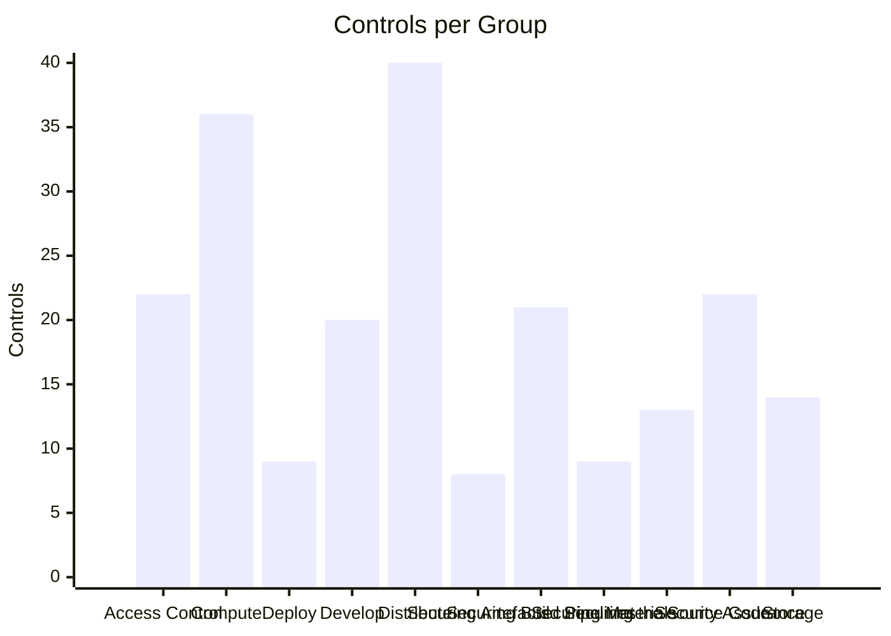

# cncf-controls OSCAL

OSCAL Catalog built from the [CNCF TAG Security and Compliance](https://github.com/cncf/contribute-site/tree/main/docs/community/tags/security-and-compliance/publications/controls-catalog) controls catalog.
Output: [trestle.ws/catalogs/cncf-controls/catalog.json](trestle.ws/catalogs/cncf-controls/catalog.json)

## Catalog Overview

214 controls across 11 groups, mapped to NIST SP 800-53 Rev. 5.

<!-- chart-start -->



<!-- chart-end -->

<!-- table-start -->

| Group | Count | Controls |
|---|:---:|---|
| Access Control | 22 | CNSC-1, CNSC-2, CNSC-3, CNSC-4, CNSC-5, CNSC-6, CNSC-7, CNSC-8, CNSC-9, CNSC-10, CNSC-11, CNSC-12, CNSC-13, CNSC-14, CNSC-15, CNSC-16, CNSC-17, CNSC-18, CNSC-19, CNSC-20, CNSC-21, CNSC-208 |
| Compute | 36 | CNSC-22, CNSC-23, CNSC-24, CNSC-25, CNSC-26, CNSC-27, CNSC-28, CNSC-29, CNSC-30, CNSC-31, CNSC-32, CNSC-33, CNSC-34, CNSC-35, CNSC-36, CNSC-37, CNSC-38, CNSC-39, CNSC-40, CNSC-41, CNSC-42, CNSC-43, CNSC-44, CNSC-45, CNSC-46, CNSC-47, CNSC-48, CNSC-49, CNSC-50, CNSC-51, CNSC-52, CNSC-53, CNSC-54, CNSC-55, CNSC-56, CNSC-233 |
| Deploy | 9 | CNSC-57, CNSC-58, CNSC-59, CNSC-60, CNSC-61, CNSC-62, CNSC-170, CNSC-171, CNSC-172 |
| Develop | 20 | CNSC-63, CNSC-64, CNSC-65, CNSC-66, CNSC-67, CNSC-68, CNSC-69, CNSC-70, CNSC-71, CNSC-72, CNSC-73, CNSC-74, CNSC-75, CNSC-76, CNSC-77, CNSC-78, CNSC-195, CNSC-259, CNSC-265, CNSC-271 |
| Distribute | 40 | CNSC-79, CNSC-80, CNSC-81, CNSC-82, CNSC-83, CNSC-84, CNSC-85, CNSC-86, CNSC-87, CNSC-88, CNSC-89, CNSC-90, CNSC-91, CNSC-92, CNSC-93, CNSC-94, CNSC-95, CNSC-96, CNSC-97, CNSC-98, CNSC-99, CNSC-100, CNSC-101, CNSC-102, CNSC-103, CNSC-104, CNSC-105, CNSC-106, CNSC-107, CNSC-108, CNSC-109, CNSC-110, CNSC-111, CNSC-112, CNSC-113, CNSC-114, CNSC-274, CNSC-297, CNSC-298, CNSC-303 |
| Securing Artefacts | 8 | CNSC-141, CNSC-142, CNSC-143, CNSC-144, CNSC-145, CNSC-146, CNSC-147, CNSC-148 |
| Securing Build Pipelines | 21 | CNSC-149, CNSC-150, CNSC-151, CNSC-152, CNSC-153, CNSC-154, CNSC-155, CNSC-156, CNSC-157, CNSC-158, CNSC-159, CNSC-160, CNSC-161, CNSC-162, CNSC-163, CNSC-164, CNSC-165, CNSC-166, CNSC-167, CNSC-168, CNSC-169 |
| Securing Materials | 9 | CNSC-173, CNSC-174, CNSC-175, CNSC-176, CNSC-177, CNSC-178, CNSC-179, CNSC-180, CNSC-181 |
| Securing the Source Code | 13 | CNSC-182, CNSC-183, CNSC-184, CNSC-185, CNSC-186, CNSC-187, CNSC-188, CNSC-189, CNSC-190, CNSC-191, CNSC-192, CNSC-193, CNSC-194 |
| Security Assurance | 22 | CNSC-115, CNSC-116, CNSC-117, CNSC-118, CNSC-119, CNSC-120, CNSC-121, CNSC-122, CNSC-123, CNSC-124, CNSC-125, CNSC-126, CNSC-196, CNSC-197, CNSC-198, CNSC-199, CNSC-200, CNSC-201, CNSC-202, CNSC-203, CNSC-204, CNSC-205 |
| Storage | 14 | CNSC-127, CNSC-128, CNSC-129, CNSC-130, CNSC-131, CNSC-132, CNSC-133, CNSC-134, CNSC-135, CNSC-136, CNSC-137, CNSC-138, CNSC-139, CNSC-140 |
| **Total** | **214** | |

<!-- table-end -->

## Usage

```bash
# Run all steps end-to-end
make all
```

Or step by step:

```bash
make download-cncf-yaml   # download CNCF YAML source files
make build-catalog        # build OSCAL catalog into trestle.ws/
make validate-catalog     # validate catalog with trestle
make update-readme        # regenerate chart and table in README.md
```

Output: [trestle.ws/catalogs/cncf-controls/catalog.json](trestle.ws/catalogs/cncf-controls/catalog.json)

### All targets

```
make help
```

## Requirements

- Python 3.x
- `compliance-trestle >= 5.2.0` (installed via `make venv`)
